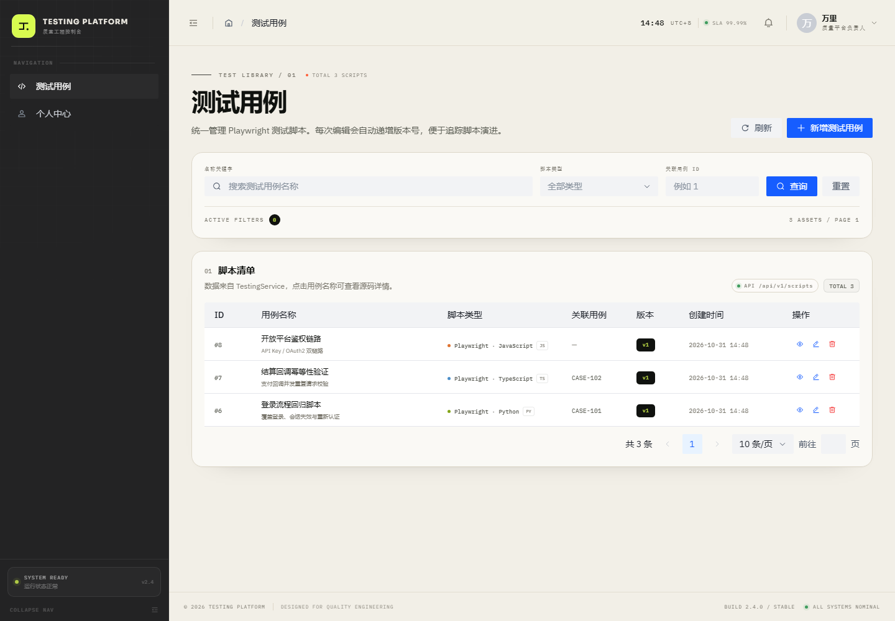
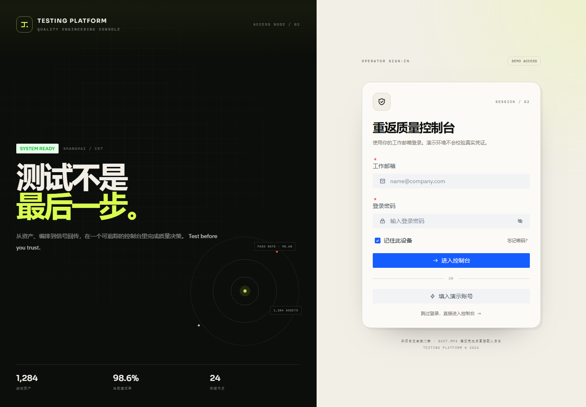
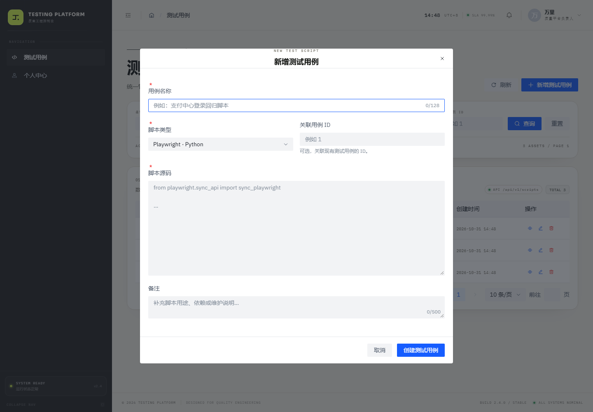
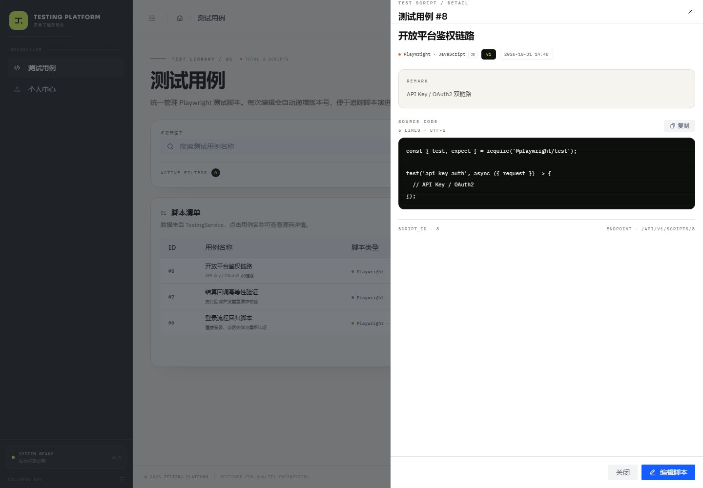

# Testing Platform

基于 **Vite + React 18（JavaScript）+ Arco Design + Tailwind CSS v3 + Axios + react-router-dom v6** 的后台管理系统。

> Arco Design 组件全部使用原生样式：项目中没有任何 `.arco-*` CSS 覆盖、主题变量重写或组件外观二次定制。Tailwind 仅用于页面布局、自定义容器和业务展示元素。

当前侧边栏包含两个业务菜单：

- **测试用例**：对接 TestingService 的真实脚本 CRUD 接口；
- **个人中心**：账号资料、安全设置与通知偏好。

登录页为隐藏的全屏路由，不占用侧边栏。



## 启动方式

先确保 TestingService 运行在 `http://127.0.0.1:8000`，接口文档：<http://127.0.0.1:8000/docs>。

```bash
cd TestingPlatform
npm install
npm run dev
```

默认访问 <http://localhost:5173>，根路径会进入 `/test-cases`。

开发环境下 `/api` 会通过 Vite 代理转发到 `http://127.0.0.1:8000`，不依赖浏览器跨域配置。

```bash
npm run build
npm run preview
```

## 页面

| 路径 | 页面 | 菜单 | 说明 |
| --- | --- | --- | --- |
| `/` | 重定向 | — | 进入 `/test-cases` |
| `/test-cases` | 测试用例 | 显示 | 脚本列表、查看、新增、编辑、删除 |
| `/profile` | 个人中心 | 显示 | 资料、安全与通知设置 |
| `/login` | 登录页 | 隐藏 | 全屏示例登录页 |
| `/404` 与 `*` | 404 | — | 未匹配路径兜底 |



## 测试用例模块

### 已接入接口

| 方法 | 路径 | 前端用途 |
| --- | --- | --- |
| `GET` | `/api/v1/scripts` | 分页查询、关键字/类型/用例 ID 筛选 |
| `GET` | `/api/v1/scripts/{script_id}` | 查看脚本详情、编辑前拉取最新数据 |
| `POST` | `/api/v1/scripts` | 新增测试用例 |
| `PUT` | `/api/v1/scripts/{script_id}` | 修改脚本并自动递增版本 |
| `DELETE` | `/api/v1/scripts/{script_id}` | 删除测试用例 |

列表查询参数：

```text
page, page_size, keyword, script_type, case_id
```

脚本类型仅允许：

```text
playwright-python
playwright-ts
playwright-js
```

新增 / 编辑表单字段：

| 字段 | 必填 | 说明 |
| --- | --- | --- |
| `name` | 是 | 用例名称，最长 128 字符 |
| `script_type` | 是 | Playwright 脚本类型 |
| `content` | 是 | 脚本源码，不能为纯空白 |
| `case_id` | 否 | 关联测试用例 ID |
| `remark` | 否 | 备注，最长 500 字符 |

新增表单：



源码详情抽屉：



### 交互说明

- 回车或点击「查询」应用筛选条件；
- 支持按名称关键字、脚本类型、关联用例 ID 过滤；
- 点击用例名称打开源码详情抽屉；
- 编辑时先调用详情接口获取最新内容，保存后版本号自动 +1；
- 删除前使用 Popconfirm 二次确认；
- 所有错误由 `request.js` 统一解析后端 `{ code, msg, data }` 响应并提示；
- 列表接口返回后按 `items / total / page / page_size / pages` 渲染分页。

## Axios 封装

[src/api/request.js](src/api/request.js) 已适配 TestingService：

- 请求头自动携带 `Content-Type: application/json`、token 与 `X-Request-Id`；
- 响应成功统一解包 `{ code, msg, data }`；
- 业务错误优先显示后端 `msg`；
- 422 参数校验错误会拼接后端字段级消息；
- 404、500、超时、断网等 HTTP / 网络异常统一提示。

接口定义集中在 [src/api/scripts.js](src/api/scripts.js)。

## 路由与菜单

[src/router/router.js](src/router/router.js) 是路由与菜单的唯一数据源：

```js
{
  path: '/test-cases',
  component: lazy(() => import('../views/TestCases')),
  meta: {
    title: '测试用例',
    icon: IconCode,
    permission: 'script:view',
    eyebrow: 'TEST LIBRARY / 01',
  },
}
```

- 侧边栏按 `meta.hidden` 与 `meta.permission` 自动过滤；
- 当前可见菜单为「测试用例」「个人中心」；
- 登录页 `meta.hidden = true`，不会出现在菜单中；
- 无权限用户手动访问受限路由会进入 404。

## 启动动画

启动动画只在当前标签页会话首次初始化时播放，刷新页面不会重复播放。实现位于 [src/hooks/useBootSequence.js](src/hooks/useBootSequence.js)，使用 `sessionStorage` 记录。

需要重新观看动画时可执行：

```js
sessionStorage.removeItem('testing-platform.boot-initialized');
location.reload();
```

`boot.mp4` 包含音轨。浏览器拦截带声音自动播放时，会先静音起播并显示「开启声音」提示；点击后恢复音轨，右上角可随时切换 `SOUND ON / SOUND OFF`。

## 目录结构

```text
TestingPlatform/
├── docs/                         # 预览截图
├── public/
│   ├── boot.mp4
│   └── favicon.svg
├── src/
│   ├── api/
│   │   ├── request.js            # Axios 统一封装
│   │   └── scripts.js            # 测试用例接口
│   ├── components/
│   │   ├── boot/BootScreen.jsx
│   │   ├── common/
│   │   │   ├── BootLoader.jsx
│   │   │   ├── BrandMark.jsx
│   │   │   ├── PageHeader.jsx
│   │   │   └── StatusTag.jsx
│   │   └── layout/
│   │       ├── Footer.jsx
│   │       ├── Header.jsx
│   │       └── Sidebar.jsx
│   ├── hooks/
│   │   ├── useBootSequence.js
│   │   ├── useClock.js
│   │   ├── useDocumentTitle.js
│   │   ├── useMediaQuery.js
│   │   └── usePermission.js
│   ├── layouts/AdminLayout.jsx
│   ├── router/
│   │   ├── index.jsx
│   │   ├── menu.js
│   │   └── router.js
│   ├── utils/
│   │   ├── auth.js
│   │   └── format.js
│   ├── views/
│   │   ├── Login/index.jsx
│   │   ├── NotFound/index.jsx
│   │   ├── Profile/index.jsx
│   │   └── TestCases/index.jsx
│   ├── App.jsx
│   ├── index.css
│   └── main.jsx
├── .env.example
├── index.html
├── package.json
├── postcss.config.js
├── tailwind.config.js
└── vite.config.js
```

## 环境变量

```bash
VITE_API_BASE_URL=/api/v1
VITE_API_PROXY_TARGET=http://127.0.0.1:8000
```

如果前端与后端分域部署，把 `VITE_API_BASE_URL` 改为真实接口地址，并确保后端 CORS 已配置。
