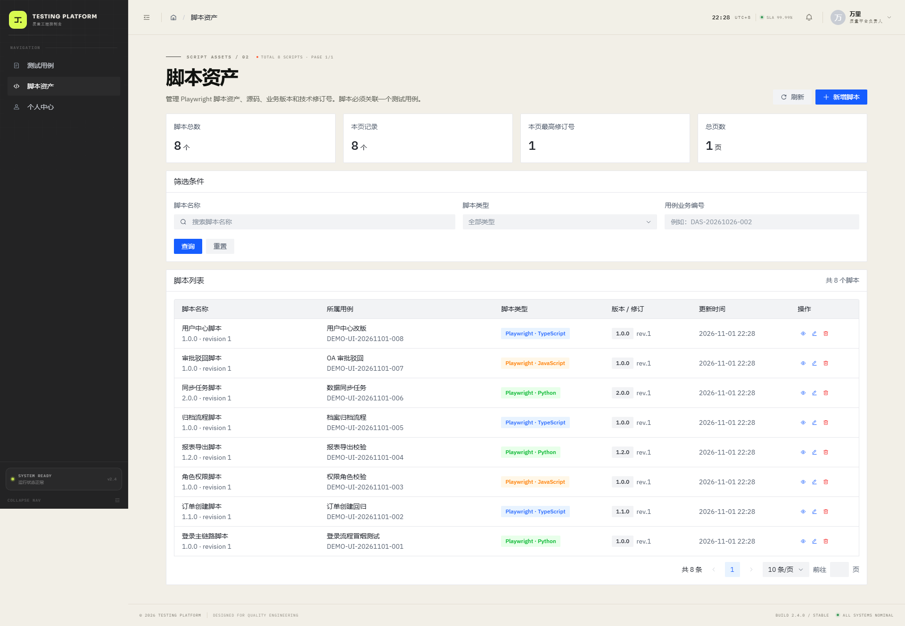
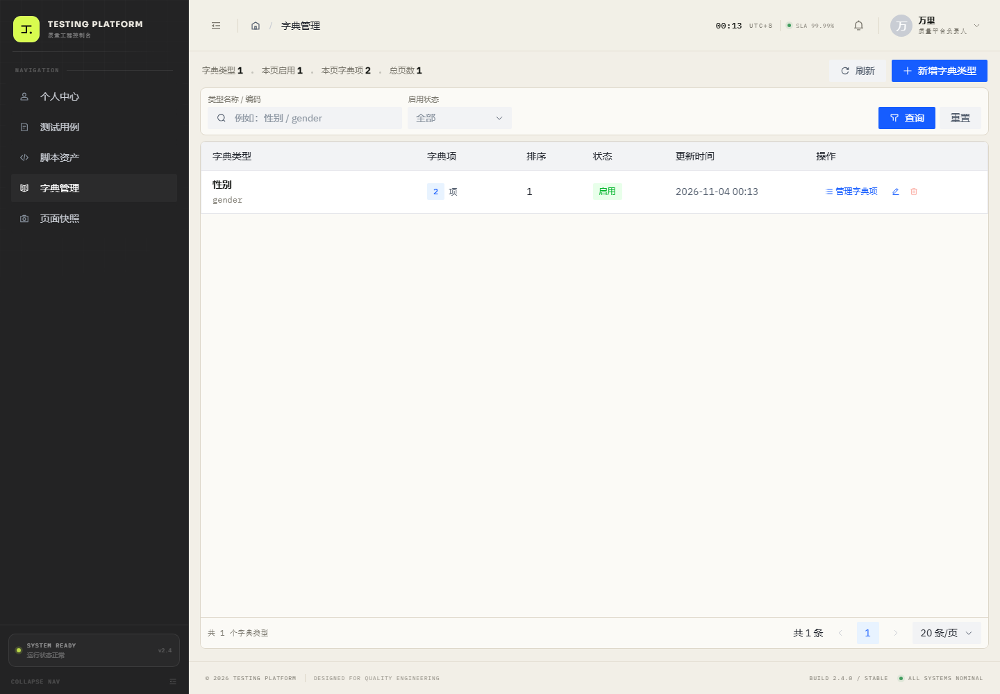
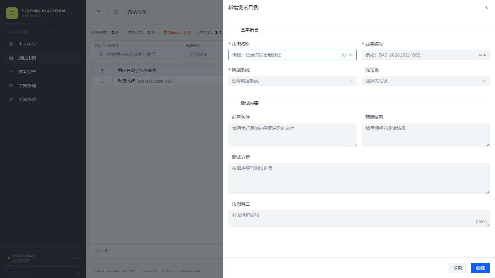
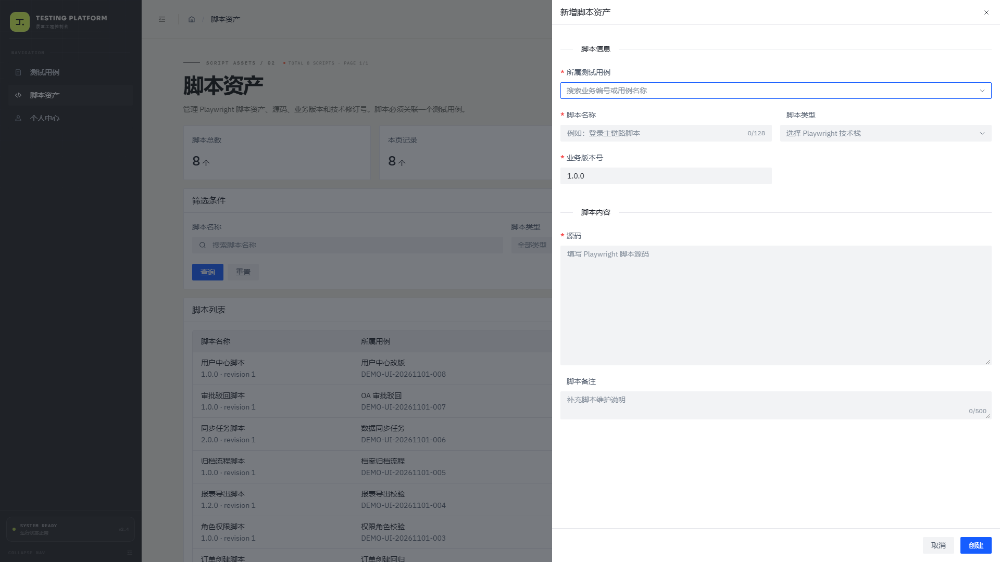

# Testing Platform

基于 **Vite + React 18（JavaScript）+ Arco Design + Tailwind CSS v3 + SCSS + Axios + react-router-dom v6** 的后台管理系统。

> Arco Design 组件全部使用原生样式：项目中没有任何 `.arco-*` CSS 覆盖、主题变量重写或组件外观二次定制。Tailwind 与 SCSS 仅用于页面布局、自定义容器和业务展示元素。
>
> 样式入口为 [src/index.scss](src/index.scss)，通过 Sass 编译；响应式断点使用 SCSS 变量统一管理，并使用原生嵌套组织品牌样式。

当前侧边栏包含以下菜单：

- **测试用例**：维护纯业务用例；
- **脚本资产**：上传、下载、预览和覆盖 Playwright 脚本文件，通过多对多关联复用于多个测试用例；
- **字典管理**：按“字典类型 → 字典项”维护键值对，例如“性别”下维护 male/男、female/女；
- **页面快照**：查看 Playwright Trace Viewer；
- **个人中心**：账号资料、安全设置与通知偏好。

业务用例与脚本资产按后端新模型彻底拆分，界面上不展示任何技术 UUID。


## 启动方式

先确保 TestingService 运行在 `http://127.0.0.1:8000`，接口文档：<http://127.0.0.1:8000/docs>。

```bash
cd TestingPlatform
npm install
npm run dev
```

默认访问 <http://localhost:5173>，根路径会进入 `/test-cases`。

开发环境下 `/api` 会通过 Vite 代理转发到 `http://127.0.0.1:8000`，不依赖浏览器跨域配置。

```bash
npm run build
npm run preview
```

## 页面

| 路径 | 页面 | 菜单 | 说明 |
| --- | --- | --- | --- |
| `/` | 重定向 | — | 进入 `/test-cases-v2` |
| `/test-cases-v2` | 测试用例 | 显示 | 业务用例 CRUD、筛选与关联脚本入口 |
| `/test-cases` | 重定向 | — | 兼容旧链接，进入 `/test-cases-v2` |
| `/test-scripts` | 脚本资产 | 显示 | 脚本文件上传/下载/预览、用例多选绑定 |
| `/dictionaries` | 字典管理 | 显示 | 字典类型与字典项两级 CRUD、筛选和启停管理 |
| `/page-snapshot` | 页面快照 | 显示 | Playwright Trace Viewer |
| `/profile` | 个人中心 | 显示 | 资料、安全与通知设置 |
| `/login` | 登录页 | 隐藏 | 全屏示例登录页 |
| `/404` 与 `*` | 404 | — | 未匹配路径兜底 |







## 业务用例模块

### 接口

| 方法 | 路径 | 用途 |
| --- | --- | --- |
| `GET` | `/api/v1/test-cases` | 分页查询；支持 keyword / system_name / priority |
| `GET` | `/api/v1/test-cases/{case_id}` | 用例详情，响应包含 `script_count` |
| `POST` | `/api/v1/test-cases` | 新增用例 |
| `PUT` | `/api/v1/test-cases/{case_id}` | 修改用例 |
| `DELETE` | `/api/v1/test-cases/{case_id}` | 删除用例；存在关联脚本时返回 409 |

用例字段：`case_no`、`name`、`system_name`、`priority`、`precondition`、`test_steps`、`expected_result`、`remark`。

- 侧边栏按名称/业务编号、所属系统、优先级筛选；
- 「所属系统」下拉选项来自字典类型 `system_name`（通过 `/api/v1/dictionaries/by-code/system_name` 获取）；
- 列表展示用例名称、业务编号、所属系统、优先级、关联脚本数、创建时间；
- 不展示 UUID；
- 用例下存在脚本时删除会展示后端 409 提示；
- 可一键跳转到脚本资产页，并按当前业务编号过滤。



## 脚本资产模块

### 接口

| 方法 | 路径 | 用途 |
| --- | --- | --- |
| `POST` | `/api/v1/test-scripts/upload` | multipart 上传文件并创建脚本，可绑定多个用例 |
| `GET` | `/api/v1/test-scripts` | 分页查询；支持 keyword / script_type / test_case_id / case_no |
| `GET` | `/api/v1/test-scripts/{script_id}` | 脚本详情与当前文件元数据 |
| `PUT` | `/api/v1/test-scripts/{script_id}` | 修改名称、类型、业务版本和备注 |
| `PUT` | `/api/v1/test-scripts/{script_id}/file` | 上传新文件覆盖当前文件 |
| `PUT` | `/api/v1/test-scripts/{script_id}/test-cases` | 全量设置关联用例 |
| `GET` | `/api/v1/test-scripts/{script_id}/download` | 下载当前文件 |
| `GET` | `/api/v1/test-scripts/{script_id}/preview` | 预览 UTF-8 文本 |
| `DELETE` | `/api/v1/test-scripts/{script_id}` | 删除脚本、当前文件和关联关系 |

脚本字段：`test_cases`、`name`、`script_type`、`file_id`、`file_name`、`file_ext`、`file_size`、`mime_type`、`file_sha256`、`version`、`remark`、`uploaded_at`。

- 新增脚本时必须选择文件，并至少选择一个测试用例；
- 用例选择器支持远程搜索和多选；
- 一个脚本可被多个用例复用；
- 列表展示脚本名称、关联用例、当前文件、类型和更新时间；
- 详情展示当前文件信息、SHA-256 和关联用例；
- 支持在线预览 UTF-8 文本、下载文件、上传新文件覆盖；
- 覆盖文件不保留历史版本，旧文件在数据库提交成功后删除；
- 界面不展示任何技术 UUID。



## 字典管理模块

### 数据模型

采用两级结构，不再把类型和字典项混在一张扁平表里：

```text
字典类型：gender / 性别
  ├── 字典项：male / 男
  └── 字典项：female / 女
```

- 字典类型字段：`type_code`、`type_name`、`description`、`sort_order`、`is_enabled`；
- 字典项字段：`item_code`（键）、`item_name`（值/显示文本）、`sort_order`、`is_enabled`、`remark`；
- 同一类型下 `item_code` 唯一；
- 类型下还有字典项时，不允许直接删除类型。

### 接口

| 方法 | 路径 | 用途 |
| --- | --- | --- |
| `GET` | `/api/v1/dictionaries/types` | 分页查询字典类型；支持 keyword / is_enabled |
| `POST` | `/api/v1/dictionaries/types` | 新增字典类型 |
| `GET` | `/api/v1/dictionaries/types/{type_id}` | 字典类型详情（含 item_count） |
| `PUT` | `/api/v1/dictionaries/types/{type_id}` | 修改字典类型 |
| `DELETE` | `/api/v1/dictionaries/types/{type_id}` | 删除字典类型；有字典项时返回 409 |
| `GET` | `/api/v1/dictionaries/types/{type_id}/items` | 分页查询字典项 |
| `POST` | `/api/v1/dictionaries/types/{type_id}/items` | 新增字典项 |
| `GET` | `/api/v1/dictionaries/types/{type_id}/items/{item_id}` | 字典项详情 |
| `PUT` | `/api/v1/dictionaries/types/{type_id}/items/{item_id}` | 修改字典项 |
| `DELETE` | `/api/v1/dictionaries/types/{type_id}/items/{item_id}` | 删除字典项 |
| `GET` | `/api/v1/dictionaries/by-code/{type_code}` | 按类型编码返回启用字典项，供下拉框使用 |

### 页面操作

- 新增字典类型：填写类型名称（性别）和类型编码（gender）；
- 点击“管理字典项”进入该类型下的键值对管理；
- 新增字典项：填写字典值（男）和字典键（male）；
- 支持字典项搜索、启停、编辑、删除；
- 列表展示每个类型下的字典项数量；有关联项时删除按钮禁用。

## Axios 封装

[src/api/request.js](src/api/request.js) 已适配 TestingService：

- 请求头自动携带 token 与 `X-Request-Id`；
- JSON 请求由 Axios 自动设置 `Content-Type: application/json`；
- 脚本上传使用 `FormData`，Axios 自动生成 multipart boundary；
- 响应成功统一解包 `{ code, msg, data }`；
- 下载响应保留 Blob 和响应头，用于读取服务端文件名；
- 业务错误优先显示后端 `msg`；
- 422 参数校验错误会拼接后端字段级消息；
- 404、500、超时、断网等 HTTP / 网络异常统一提示。

接口定义集中在：

- [src/api/testCases.js](src/api/testCases.js)
- [src/api/testScripts.js](src/api/testScripts.js)
- [src/api/dictionaries.js](src/api/dictionaries.js)

## 路由与菜单

[src/router/router.js](src/router/router.js) 是路由与菜单的唯一数据源：

```js
{
  path: '/test-scripts',
  component: lazy(() => import('../views/TestScripts')),
  meta: {
    title: '脚本资产',
    icon: IconCode,
    permission: 'script:view',
    eyebrow: 'SCRIPT ASSETS / 02',
  },
}
```

- 侧边栏按 `meta.hidden` 与 `meta.permission` 自动过滤；
- 当前可见菜单为「测试用例」「脚本资产」「个人中心」；
- 测试用例与脚本资产使用独立的路由、页面和 API 资源；
- 登录页 `meta.hidden = true`，不会出现在菜单中；
- 无权限用户手动访问受限路由会进入 404。

## 启动动画

启动动画只在当前标签页会话首次初始化时播放，刷新页面不会重复播放。实现位于 [src/hooks/useBootSequence.js](src/hooks/useBootSequence.js)，使用 `sessionStorage` 记录。

需要重新观看动画时可执行：

```js
sessionStorage.removeItem('testing-platform.boot-initialized');
location.reload();
```

`boot.mp4` 包含音轨。浏览器拦截带声音自动播放时，会先静音起播并显示「开启声音」提示；点击后恢复音轨，右上角可随时切换 `SOUND ON / SOUND OFF`。

## 目录结构

```text
TestingPlatform/
├── docs/                         # 预览截图
├── public/
│   ├── boot.mp4
│   └── favicon.svg
├── src/
│   ├── api/
│   │   ├── request.js            # Axios 统一封装
│   │   ├── testCases.js          # 业务用例接口
│   │   ├── testScripts.js        # 脚本资产接口
│   │   └── dictionaries.js       # 字典管理接口
│   ├── components/
│   │   ├── boot/BootScreen.jsx
│   │   ├── common/
│   │   │   ├── BootLoader.jsx
│   │   │   ├── BrandMark.jsx
│   │   │   ├── FormLabel.jsx
│   │   │   ├── PageHeader.jsx
│   │   │   └── StatusTag.jsx
│   │   ├── test/TestCaseSelect.jsx # 远程用例选择器（支持多选）
│   │   ├── test/ScriptFilePicker.jsx # 脚本文件选择与校验
│   │   └── layout/
│   │       ├── Footer.jsx
│   │       ├── Header.jsx
│   │       └── Sidebar.jsx
│   ├── hooks/
│   │   ├── useBootSequence.js
│   │   ├── useClock.js
│   │   ├── useDocumentTitle.js
│   │   ├── useMediaQuery.js
│   │   └── usePermission.js
│   ├── layouts/AdminLayout.jsx
│   ├── router/
│   │   ├── index.jsx
│   │   ├── menu.js
│   │   └── router.js
│   ├── utils/
│   │   ├── auth.js
│   │   └── format.js
│   ├── views/
│   │   ├── Dictionaries/index.jsx
│   │   ├── Login/index.jsx
│   │   ├── NotFound/index.jsx
│   │   ├── PageSnapshot/index.jsx
│   │   ├── Profile/index.jsx
│   │   ├── TestCases/index.jsx
│   │   ├── TestCasesV2/index.jsx
│   │   └── TestScripts/index.jsx
│   ├── App.jsx
│   ├── index.scss
│   └── main.jsx
├── .env.example
├── index.html
├── package.json
├── postcss.config.js
├── tailwind.config.js
└── vite.config.js
```

## 环境变量

```bash
VITE_API_BASE_URL=/api/v1
VITE_API_PROXY_TARGET=http://127.0.0.1:8000
```

如果前端与后端分域部署，把 `VITE_API_BASE_URL` 改为真实接口地址，并确保后端 CORS 已配置。

## 样式系统

- **Arco Design**：全部使用组件库原生样式，没有 `.arco-*` 覆盖、主题变量重写或组件外观 CSS。
- **SCSS**：样式入口为 `src/index.scss`，由 Vite 内置的 Sass 支持编译；响应式断点使用 SCSS 变量统一管理，自定义品牌样式使用 SCSS 嵌套。
- **Tailwind CSS v3**：用于页面布局、间距、响应式网格和自定义容器。
- 自定义视觉只作用于页面壳、业务容器、品牌图形和源码预览等非 Arco 元素。
