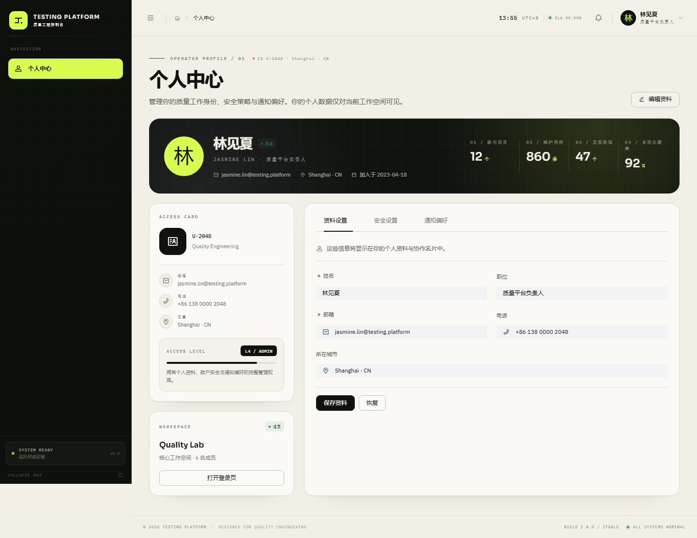
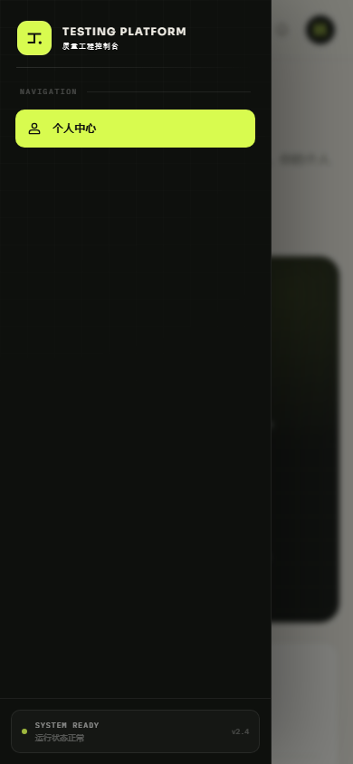

# Testing Platform

基于 **Vite + React 18（JavaScript）+ Arco Design + Tailwind CSS v3 + Axios + react-router-dom v6** 的后台管理系统。

当前按需求只保留两个模块：**个人中心** 与 **登录页**。仪表盘、用例库、任务编排等业务模块及其专属页面、组件、Mock API 已移除；404 页面保留作为兜底。



## 启动方式

环境要求：Node.js 18+（推荐 20+）。

```bash
cd TestingPlatform
npm install
npm run dev
```

默认访问 <http://localhost:5173>，根路径会进入 `/profile`。

```bash
npm run build
npm run preview
```

## 当前页面

| 路径 | 页面 | 菜单 | 说明 |
| --- | --- | --- | --- |
| `/` | 重定向 | — | 进入 `/profile` |
| `/profile` | 个人中心 | 显示 | 资料设置、安全设置、通知偏好 |
| `/login` | 登录页 | 隐藏 | 全屏示例登录页，不构成登录门禁；可从个人中心按钮或用户菜单进入 |
| `/404` 与 `*` | 404 | — | 未匹配路径的兜底页面 |


移动端侧边菜单：



## 目录结构

```text
TestingPlatform/
├── docs/                         # 预览截图
├── public/
│   ├── boot.mp4                  # 前置启动动画
│   └── favicon.svg
├── src/
│   ├── api/
│   │   └── request.js            # Axios 统一封装（保留基础层）
│   ├── components/
│   │   ├── boot/BootScreen.jsx
│   │   ├── common/
│   │   │   ├── BootLoader.jsx
│   │   │   ├── BrandMark.jsx
│   │   │   ├── PageHeader.jsx
│   │   │   └── StatusTag.jsx
│   │   └── layout/
│   │       ├── Footer.jsx
│   │       ├── Header.jsx
│   │       └── Sidebar.jsx
│   ├── hooks/
│   │   ├── useBootSequence.js
│   │   ├── useClock.js
│   │   ├── useDocumentTitle.js
│   │   ├── useMediaQuery.js
│   │   └── usePermission.js
│   ├── layouts/AdminLayout.jsx
│   ├── router/
│   │   ├── index.jsx
│   │   ├── menu.js
│   │   └── router.js
│   ├── utils/
│   │   ├── auth.js
│   │   └── format.js
│   ├── views/
│   │   ├── Login/index.jsx
│   │   ├── NotFound/index.jsx
│   │   └── Profile/index.jsx
│   ├── App.jsx
│   ├── index.css
│   └── main.jsx
├── .env.example
├── index.html
├── package.json
├── postcss.config.js
├── tailwind.config.js
└── vite.config.js
```

## 路由与菜单

[src/router/router.js](src/router/router.js) 是路由与侧边菜单的唯一数据源：

```js
export const appRoutes = [
  {
    path: '/profile',
    component: lazy(() => import('../views/Profile')),
    meta: {
      title: '个人中心',
      icon: IconUser,
      permission: 'profile:view',
      eyebrow: 'OPERATOR PROFILE / 01',
    },
  },
  {
    path: '/login',
    component: lazy(() => import('../views/Login')),
    meta: {
      title: '登录页',
      icon: IconLock,
      hidden: true,
      blank: true,
    },
  },
];
```

- 侧边栏由 `meta` 自动生成，不再手写菜单数组。
- 当前侧边栏只显示「个人中心」；登录页属于隐藏路由，不进入业务菜单。
- 登录页使用 `blank` 全屏布局，可通过个人中心「打开登录页」或用户菜单「退出登录」进入；页面底部的「跳过登录，直接进入控制台」可返回个人中心。
- 无权限路由会同时从菜单过滤并触发路由守卫，落到 404。
- 根路径 `/` 重定向到 `/profile`。

## 启动动画

启动动画只在**当前标签页会话首次初始化**时播放：

- 第一次打开或新标签页：播放 `public/boot.mp4`；
- 浏览器刷新、页内路由跳转：不再加载启动动画，直接进入后台；
- 关闭标签页后重新打开：视为新的初始化，再次播放。

实现位于 [src/hooks/useBootSequence.js](src/hooks/useBootSequence.js)，使用 `sessionStorage` 记录 `testing-platform.boot-initialized`。

开发时需要重看动画，可在浏览器控制台执行：

```js
sessionStorage.removeItem('testing-platform.boot-initialized');
location.reload();
```

如果希望整台浏览器只播放一次（永久记住），把该 hook 中的 `sessionStorage` 改为 `localStorage` 即可。

### 视频声音

`boot.mp4` 包含音轨，[BootScreen.jsx](src/components/boot/BootScreen.jsx) 会：

1. 优先尝试带声音自动播放；
2. 如果被浏览器自动播放策略拦截，则静音起播并显示「开启声音」提示；
3. 点击后恢复音轨，右上角 `SOUND ON / SOUND OFF` 可随时切换；
4. 视频正常结束后淡出并载入后台。

浏览器不允许网页在无用户交互时带声音自动播放，这是平台策略，并非代码禁用了音轨。

## Axios 基础层

[src/api/request.js](src/api/request.js) 保留了统一请求能力：

- 请求拦截自动携带 `Authorization: Bearer <token>` 与 `X-Request-Id`；
- 响应拦截统一处理 `{ code, data, message }`；
- 401、HTTP 错误、超时、断网统一通过 Arco `Message` 提示；
- 后续新增业务模块时，直接在 `src/api/` 下增加接口文件即可。

当前页面没有实际后端请求。环境变量示例：

```bash
VITE_API_BASE_URL=/api
```

## 技术说明

- UI 组件仅使用 Arco Design，无其他 UI 库。
- 样式使用 Tailwind CSS v3 + 自定义 CSS 变量。
- 路由使用 react-router-dom v6。
- 启动动画按标签页会话去重，刷新不重复播放。
